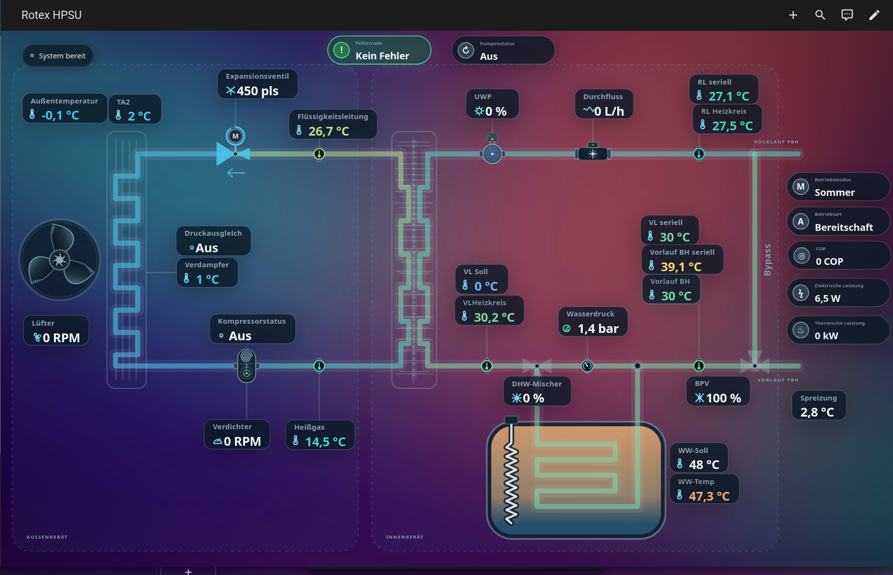

# Rotex HPSU Schema Card

Eine Custom-Lovelace-Karte für Home Assistant, die den Betrieb einer Rotex HPSU als animiertes Anlagenschema darstellt. Temperaturen, Statuswerte und Leistungsdaten werden in verschiebbaren Kacheln angezeigt. Die Sensoren werden anhand eines gemeinsamen Präfixes zugeordnet oder können einzeln konfiguriert werden.




## Features

- Animiertes Schema mit Außengerät, Verdampfer, Verdichter, Wärmetauscher, Speicher und Heizkreis.
- Anzeige von Temperaturen, Durchfluss, Wasserdruck, Betriebs- und Komponentenstatus, Leistung und COP.
- Heizkreiswerte einschließlich **Rücklauf seriell**, **Vorlauf seriell** und Vorlauf BH seriell.
- Automatische Zuordnung über `prefix` sowie optionale individuelle Entitäten, Labels und zusätzliche Kacheln.
- Einstellbare Darstellung und Hintergrund; die Karte skaliert proportional mit ihrer Breite.
- Positionen der Messwertkacheln können im Home-Assistant-Dashboard angepasst werden.

## Voraussetzungen

- Home Assistant mit Lovelace-Dashboard.
- Die verwendeten Entitäten müssen in Home Assistant vorhanden und für die Karte zugänglich sein. Die Standardzuordnung ist auf Entitäten mit dem Präfix `rotex_atom_` ausgelegt; eigene IDs lassen sich konfigurieren.
- Für automatische Positionsspeicherung in Home Assistant muss die Karte auf die Home-Assistant-WebSocket-Verbindung zugreifen können. Bei fehlender Verbindung bleibt der lokale Browser-Cache als Fallback.

## Installation

### HACS (benutzerdefiniertes Repository)

1. In HACS **Frontend** öffnen und **Benutzerdefinierte Repositories** auswählen.
2. Repository-URL eintragen: `https://github.com/Trunks1982/hpsu-schema-card`
3. Kategorie **Dashboard** wählen und das Repository hinzufügen.
4. Die Karte installieren und Home Assistant bzw. den Browser bei Bedarf neu laden.

> Der Quellcode nennt das oben angegebene Repository als Dokumentationsadresse. Verfügbarkeit, Veröffentlichungen und konkrete HACS-Paketstruktur bitte im Repository prüfen.

## Konfiguration

Minimalbeispiel für ein Lovelace-Dashboard:

```yaml
type: custom:hpsu-schema-card
prefix: rotex_atom_
```

Vollständigeres Beispiel mit exemplarischen Anpassungen:

```yaml
type: custom:hpsu-schema-card
prefix: rotex_atom_
height: 0
style: normal
background: dark
palette: auto
frames: on
value_font: std
tile_size: 100
label_size: 100
heading_size: 100
long_press_edit: true
entities:
  cop: sensor.cop_wert
  buh_power: sensor.heizstab_leistung
labels:
  ta: Draußen
  speicher: Warmwasser
extra:
  - entity: sensor.keller_temperatur
    label: Keller
positions:
  ta: [95, 105]
```

`positions` verwendet Schema-Pixel; das Schema ist 1600 × 940. Nicht angegebene Positionen bleiben auf Standardposition. Den Schlüssel `ta` zeigt das Beispiel als Ausschnitt; die Liste der gültigen Standardschlüssel steht weiter unten. Werte in `entities` müssen gültige Entity-IDs sein. Bei den optionalen `extra`-Kacheln sind `entity` und optional `label` verwendbar.

### Optionen

| Option | Typ / Werte | Bedeutung |
|---|---|---|
| `type` | `custom:hpsu-schema-card` | Karten-Typ, erforderlich. |
| `prefix` | Text, z. B. `rotex_atom_` | Ersetzt den Namensbestandteil `rotex_atom_` in den Standard-Entitäten. Individuelle Werte aus `entities` überschreiben die daraus abgeleiteten IDs. |
| `height` | Zahl in px, `0`–`1400` im Editor | Feste Kartenhöhe; `0` bzw. nicht angegeben verwendet die automatische, aus der Breite abgeleitete Höhe. |
| `style` | `normal`, `calm` | Darstellungsstil; `calm` verwendet flache Kacheln ohne Rand. |
| `background` | `dark`, `light`, `transparent`, `ha`, `solid`, `gradient`, `image` | Hintergrundmodus: dunkel, hell, transparent, HA-Theme, Volltonfarbe, Verlauf oder Bild. Der Karten-Editor bietet die ersten vier Auswahlwerte; `solid`, `gradient` und `image` werden von der Kartenkonfiguration verarbeitet. |
| `background_color` | CSS-Farbwert | Farbe bei `background: solid`. |
| `background_color_a`, `background_color_b` | CSS-Farbwerte | Erste und zweite Farbe bei `background: gradient`. |
| `background_image` | URL/Pfad | Bildadresse bei `background: image`. |
| `palette` | `auto`, `dark`, `mid`, `light` | Farbpalette der Schemaelemente. |
| `frames` | `on`, `off` (auch Boolean verarbeitet) | Kachelrahmen ein- oder ausblenden. |
| `value_font` | `std`, `tab`, `mono` | Schrift der Messwerte: Standard, Ziffern gleicher Breite oder Monospace. |
| `tile_size` | Prozent, 60–200 | Größe der Kachelwerte. |
| `label_size` | Prozent, 70–160 | Größe der Kachelbeschriftungen. |
| `heading_size` | Prozent, 60–200 | Größe der Schema-Überschriften. |
| `long_press_edit` | Boolean, Standard `true` | `false` deaktiviert den Einstieg in die Kachel-Positionsbearbeitung durch langes Drücken. |
| `entities` | Objekt aus Standardschlüssel → Entity-ID | Individuelle Entitätszuordnung; nicht angegebene Einträge behalten die Standard-/Präfixzuordnung. |
| `labels` | Objekt aus Standardschlüssel → Text | Überschreibt Beschriftungen; leere bzw. fehlende Werte verwenden den Standardtext. |
| `extra` | Liste mit `entity` (oder Entity-ID als String) und optional `label` | Zusätzliche Messwertkacheln für eigene Entitäten. |
| `positions` | Objekt aus Schlüssel → `[x, y]` | Kachelpositionen in SVG-Pixeln (Schema 1600 × 940). |
| `storage_key` | Text | Optionaler Schlüssel für das Speichern/Laden der Positionsdaten in Home-Assistant-Benutzerdaten. Ohne Angabe verwendet die Karte ihren Standardschlüssel und unterscheidet Layouts intern anhand der Kartenkonfiguration. |

### Standard-Entitäten und Schlüssel

Die folgende Zuordnung entspricht dem im Code hinterlegten Standard. Bei abweichenden Entity-IDs `entities` verwenden; `prefix` ersetzt in den Standard-IDs den Teil `rotex_atom_`.

| Schlüssel | Angezeigtes Element | Standard-Entity-ID |
|---|---|---|
| `ta` | Außentemperatur | `sensor.rotex_atom_can_aussentemperatur` |
| `ta2` | Außenfühler TA2 | `sensor.rotex_atom_serial_outdoor_air_temp` |
| `expansion_valve` | Expansionsventil | `sensor.rotex_atom_serial_expansionsventil` |
| `pressure_equalization` | Druckausgleich | `binary_sensor.rotex_atom_serial_druckausgleich` |
| `kondensat` | Flüssigkeitsleitung | `sensor.rotex_atom_serial_temperatur_fl_ssigkeitsleitung` |
| `umwaelzpumpe` | Umwälzpumpe | `sensor.rotex_atom_can_umwaelzpumpe` |
| `umwaelzpumpe_an_aus` | Pumpenstatus | `binary_sensor.rotex_atom_can_status_kesselpumpe` |
| `durchfluss` | Durchfluss | `sensor.rotex_atom_can_durchfluss` |
| `ruecklauf_1` | Rücklauf Heizkreis | `sensor.rotex_atom_can_ruecklauftemperatur_heizung` |
| `ruecklauf_2` | Rücklauf seriell | `sensor.rotex_atom_serial_r_cklauftemperatur` |
| `verdampfer` | Verdampfer | `sensor.rotex_atom_serial_temperatur_lamellenw_rmetauscher` |
| `hot_gas` | Heißgas | `sensor.rotex_atom_serial_temperatur_nach_k_ltemittelverdichter` |
| `spread` | Spreizung | `sensor.rotex_atom_can_spreizung` |
| `vorlauf_1` | Vorlauf Heizkreis | `sensor.rotex_atom_can_heizkreis_vorlauf_tv` |
| `vorlauf_2` | Vorlauf seriell | `sensor.rotex_atom_serial_vorlauftemeratur_tv` |
| `vorlauf_soll` | Vorlauf Soll | `sensor.rotex_atom_can_vorlauf_soll` |
| `wasserdruck` | Wasserdruck | `sensor.rotex_atom_can_wasserdruck` |
| `vorlauf_bh_1` | Vorlauf BH | `sensor.rotex_atom_can_vorlauftemperatur_heizung_tvbh` |
| `vorlauf_bh_2` | Vorlauf BH seriell | `sensor.rotex_atom_serial_vorlauftemeratur_tvbh` |
| `kompressor_an_aus` | Kompressorstatus | `binary_sensor.rotex_atom_can_status_kompressor` |
| `luefter` | Lüfter | `sensor.rotex_atom_serial_ventilatordrehzahl` |
| `verdichter` | Verdichter | `sensor.rotex_atom_serial_kompressor_drehzahl` |
| `speicher` | Warmwasserspeicher | `sensor.rotex_atom_can_warmwassertemperatur` |
| `speicher_soll` | Speicher Soll | `select.rotex_atom_can_t_ww_soll1` |
| `mischer` | DHW-Mischer | `sensor.rotex_atom_can_dhw_mischer_position` |
| `bypass` | Bypass | `sensor.rotex_atom_can_bpv` |
| `fehlercode` | Fehlercode | `sensor.rotex_atom_can_fehlercode` |
| `betriebsmodus` | Betriebsmodus | `select.rotex_atom_can_betriebsmodus` |
| `betriebsart` | Betriebsart | `sensor.rotex_atom_can_betriebsart` |
| `thermische_leistung` | Thermische Leistung | `sensor.wp_thermische_leistung` |
| `el_power` | Elektrische Leistung | `sensor.wp_channel_a_power` |
| `cop` | COP | `sensor.cop_wert` |
| `buh_power` | Heizstab | nicht vorbelegt (leerer Standardwert) |

## Bedienung: Kacheln verschieben

1. Das Lovelace-Dashboard in den **Bearbeitungsmodus** versetzen.
2. Eine Kachel etwa **600 ms lang gedrückt halten**. Wird sie vorher um mehr als wenige Pixel bewegt, wird der Langdruck abgebrochen.
3. Sobald der Verschiebe-Modus sichtbar ist, die Kachel mit gedrückter Maustaste bzw. gedrücktem Finger an die gewünschte Stelle ziehen und loslassen.
4. Nach **1 Sekunde ohne weitere Bewegung/Bedienung** speichert die Karte die Position automatisch und beendet den Verschiebe-Modus. Beim Verlassen des HA-Dashboard-Bearbeitungsmodus wird ein noch offener Positionsmodus ebenfalls beendet.
5. Optional lassen sich ausgewählte Kacheln im Verschiebe-Modus mit den Pfeiltasten bewegen: **1 px** pro Tastendruck, mit **Shift 10 px**.

Positionen werden lokal im Browser (`localStorage`, layoutbezogener Schlüssel `hpsu-layout-v1-…`; zusätzlich existiert der Fallback `hpsu-tag-positions-v3`) zwischengespeichert und außerdem als Home-Assistant-Benutzerdaten gespeichert (Standardschlüssel `hpsu_schema_card_positions`, optional anpassbar mit `storage_key`). Bei Kartenkonfigurationen wird das Layout intern anhand von Präfix, Entitäten, Zusatzkacheln und Bildadresse unterschieden. Ist die HA-Verbindung zum Speichern nicht verfügbar, bleibt der lokale Cache erhalten. Eine in YAML gesetzte `positions`-Option kann Positionen vorgeben.

> **Hinweis zur aktuellen Quelldatei:** Der Dashboard-Bearbeitungsmodus wird erkannt und beim Verlassen wird ein offener Positionsmodus geschlossen. Der Langdruck-Handler selbst prüft jedoch nicht, ob der HA-Bearbeitungsmodus aktiv ist. Deshalb kann die Dokumentation für diese Version nicht garantieren, dass der Verschiebe-Modus ausschließlich im HA-Bearbeitungsmodus gestartet werden kann. Die Schritte oben beschreiben die empfohlene Bedienung im Dashboard-Bearbeitungsmodus.

## Tipps und Fehlerbehebung

- Nach der Installation den Browser-Cache mit **Strg+F5** (macOS: **Cmd+Shift+R**) hart neu laden.
- Werden Werte nicht angezeigt, prüfen, ob Entity-ID und Entity-Domain stimmen, die Entität in Home Assistant existiert und ihr Wert verfügbar ist. Bei einer Präfix-Installation zuerst kontrollieren, ob die resultierenden Entity-IDs tatsächlich `rotex_atom_` verwenden.
- Für einzelne abweichende IDs `entities:` benutzen. Ungültige oder nicht vorhandene IDs liefern keine aktuellen Sensorwerte.
- Wird eine Kachelposition nicht dauerhaft übernommen, Browser-Speicherung sowie die Verbindung der Karte zu Home Assistant prüfen. Die Karte nutzt bei einem Speicherfehler weiterhin den lokalen Cache.
- Hintergrundbilder benötigen eine für Home Assistant erreichbare Bild-URL; bei lokalen Dateien muss der Pfad auf die jeweilige HA-Ressource zeigen.

## Lizenz


## Lizenz

Dieses Projekt steht unter der MIT-Lizenz. Siehe die Datei [LICENSE](LICENSE).
