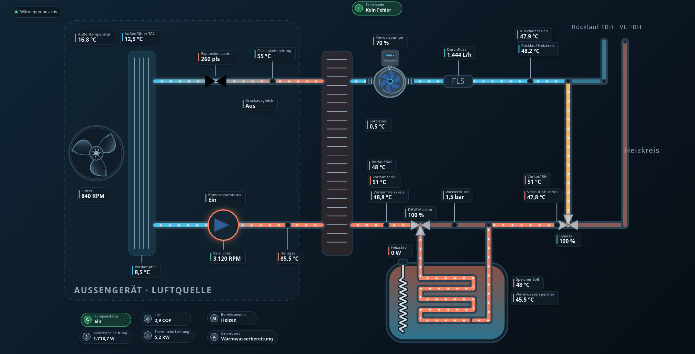

# Rotex HPSU Schema Card für Home Assistant

Eine benutzerdefinierte Lovelace-Karte (Custom Card) für Home Assistant zur dynamischen Visualisierung des Anlagenschemas einer **Rotex HPSU** Wärmepumpe.

## 🌟 Features
* **Dynamische Ansicht:** Interaktives SVG-Anlagenschema für die Rotex HPSU.
* **HACS-Integration:** Einfache Installation und automatische Updates über HACS.
* **Kein Caching-Problem:** Automatisches Neuladen des Schemas für immer aktuelle Daten.

---

## 📋 Voraussetzungen

Damit die Karte das Schema anzeigen kann, muss die Datei `hpsu-schema.html` auf deinem Home-Assistant-System im `www`-Ordner liegen:

* **Speicherort:** `/config/www/hpsu-schema.html`
* **Erreichbarkeit:** Über den Webserver unter `/local/hpsu-schema.html`

> **Hinweis:** Falls der Ordner `www` in deinem `/config/`-Verzeichnis noch nicht existiert, erstelle ihn einfach manuell (z. B. über den *Studio Code Server*, *File Editor* oder via *Samba Share*).

---

## 📦 Installation über HACS

1. Öffne **HACS** in deinem Home Assistant.
2. Gehe auf **Dashboard** (oder *Frontend*).
3. Klicke oben rechts auf die drei Punkte (⋮) und wähle **Benutzerdefinierte Repositories**.
4. Trage folgende Daten ein:
   * **Repository:** `https://github.com/Trunks1982/hpsu-schema-card`
   * **Typ / Kategorie:** `Dashboard`
5. Klicke auf **Hinzufügen**.
6. Suche in HACS nach **Rotex HPSU Schema Card** und klicke unten rechts auf **Herunterladen**.
7. Lade die Benutzeroberfläche neu, wenn Home Assistant dich dazu auffordert.

---

## ⚙️ Nutzung im Dashboard

Erstelle ein neues Dashboard. Dann klicke auf Dashboard bearbeiten und stelle das Layout auf Panel um. Wenn dies nicht funktioniert lösche vorher alle Abschnitte oder Kacheln die sich auf dem Dashboard befinden. Jetzt solltest du das Layout ändern können. Jetzt füge eine neue karte hinzu. Suche nach der Karte "Rotex HPSU Schema-Karte", klicke drauf und speicher Sie.

---

## 🎨 Anpassungen & Konfiguration

Das Anlagenschema bringt integrierte Werkzeuge mit, mit denen du das Layout, die Entitäten und den Hintergrund direkt im Browser anpassen kannst, ohne den Code mühsam manuell umschreiben zu müssen.

### 1. 📍 Layout bearbeiten & Kacheln verschieben
1. Öffne die Ansicht mit deiner HPSU-Schema-Karte in Home Assistant.
2. Über dem Schema siehst du (je nach Modus) Steuerelemente. Klicke auf den Button **Layout bearbeiten**.
3. Du kannst nun die einzelnen Sensor-Kacheln per Drag-and-Drop mit der Maus an die gewünschte Position auf dem Schema ziehen.
4. Klicke auf **Speichern**, um die neuen Positionen festzulegen. Über den **Export**-Button kannst du die neuen Koordinaten bei Bedarf direkt auslesen.

### 2. 🔌 Entitäten anpassen
1. Klicke in der Steuerungsleiste auf den Button **Entitäten**.
2. Es öffnet sich ein Konfigurationsfenster, in dem alle Kacheln aufgelistet sind.
3. Du kannst hier jeder Kachel ganz bequem eine andere Home-Assistant-Entity zuweisen oder die Suche/Filterfunktion nutzen. *(Hinweis: Leere Felder blenden die jeweilige Kachel automatisch aus).*
4. Klicke auf **Speichern**, um die Änderungen für deinen Browser zu übernehmen.

### 3. 🖼️ Hintergrund & Design anpassen
1. Klicke auf den Button **Hintergrund** (Drop-down-Menü).
2. Du kannst aus verschiedenen Modi wählen:
   * **HA-Theme:** Passt sich automatisch an dein aktuelles Home-Assistant-Theme an.
   * **Dunkel / Hell Standard:** Klassische voreingestellte Farbpaletten.
   * **Transparent / Einfarbig / Verlauf:** Definiere eigene Farben oder Farbverläufe direkt über Farbwähler.
   * **Bild per URL:** Hinterlege ein eigenes Hintergrundbild (z. B. unter `/local/dein-bild.jpg`).

> **ℹ️ Wichtiger Hinweis zur Speicherung (Pro-Benutzer-Einstellung):**
> 
> Die individuellen Anpassungen (Positionen der Kacheln, Entitäten-Zuordnungen und Hintergründe) werden **lokal im Browser des jeweiligen Geräts/Benutzers** gespeichert. 
> 
> * Das bedeutet: Wenn ein anderer Benutzer (oder ein anderes Wandtablet/Smartphone) das Schema aufruft, muss die Karte **einmalig nach den eigenen Wünschen angepasst** werden. 
> * **Tipp für Admins:** Möchtest du dein gewähltes Layout fest für alle Nutzer als Standard vorgeben? Nutze nach dem Anpassen einfach den **Export**-Button, erstelle die Einstellungen als Standard im Code und speichere sie ab.

